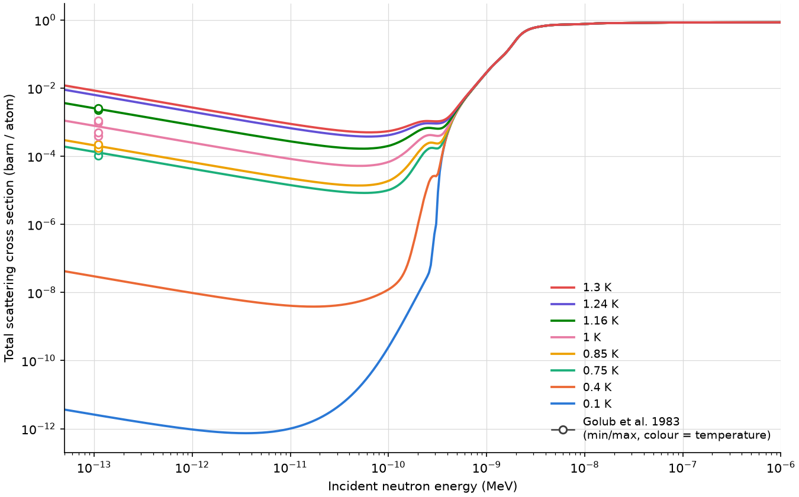

# SuperfluidHe NCrystal plugin

Neutron scattering in superfluid helium-4 at 0.1-1.3 K for NCrystal, with the
model of J.R. Granada, D.D. DiJulio, J.I. Marquez Damian et al., Nucl. Instrum.
Methods Phys. Res. A 1053 (2023) 168284: a single-phonon line of finite width on
the measured dispersion relation, plus multiphonon scattering from the density
of states. The plugin provides total scattering cross sections and samples
scattering events for Monte Carlo transport.

## Shipped materials

`He4_Superfluid_T<T>K.ncmat` for T = 0.1, 0.4, 0.75, 0.85, 1, 1.16, 1.24 and
1.3 K, each at its own temperature only, e.g.
`NCrystal.load("plugins::SuperfluidHe/He4_Superfluid_T1.3K.ncmat")`.



Total scattering cross sections of the shipped materials, with the data of
R. Golub et al., Z. Phys. B 51 (1983) 187.

## Material files

The plugin reads an NCMAT file for helium-4 that gives the density of states the
standard NCrystal way (`@DYNINFO` of type `vdos`, energies in eV), with this
added section:

```
@DYNINFO
 element He4
 fraction 1
 type vdos
 vdos_egrid 1e-05 0.0018
 vdos_density 5.12995e-06 2.7148e-05 7.19156e-05 ...
  ...
@CUSTOM_SUPERFLUIDHE
 fwhm_meV 0.0112
 z_q 53
  0 0.00078369
  ...
 h_q 53
  0 0
  ...
 phonons_meV 73
  0 0
  ...
```

- `fwhm_meV` (optional): full width at half maximum of the single-phonon line
  in meV, the same at all Q. Without it, the plugin uses the width of Y. Abe and
  N. Morishima, Nucl. Instrum. Methods Phys. Res. A 459 (2001) 256, Eqs.
  A.6-A.7, at the material temperature (as in the 0.1 and 0.4 K files).
- `z_q`, `h_q`: single-phonon and multiphonon strengths Z(Q) and H(Q); the
  number of points, then Q (1/Aa) and value on each line.
- `phonons_meV`: dispersion relation; the number of points, then Q (1/Aa) and
  energy (meV) on each line.

The temperature must be 0.1-1.3 K. A file without `@TEMPERATURE` takes its
temperature from the NCrystal cfg-string, e.g. `myfile.ncmat;temp=0.6K`.

The model is used for neutron energies up to 1 eV; above 1 eV the plugin uses
NCrystal's free-gas model for helium-4.
